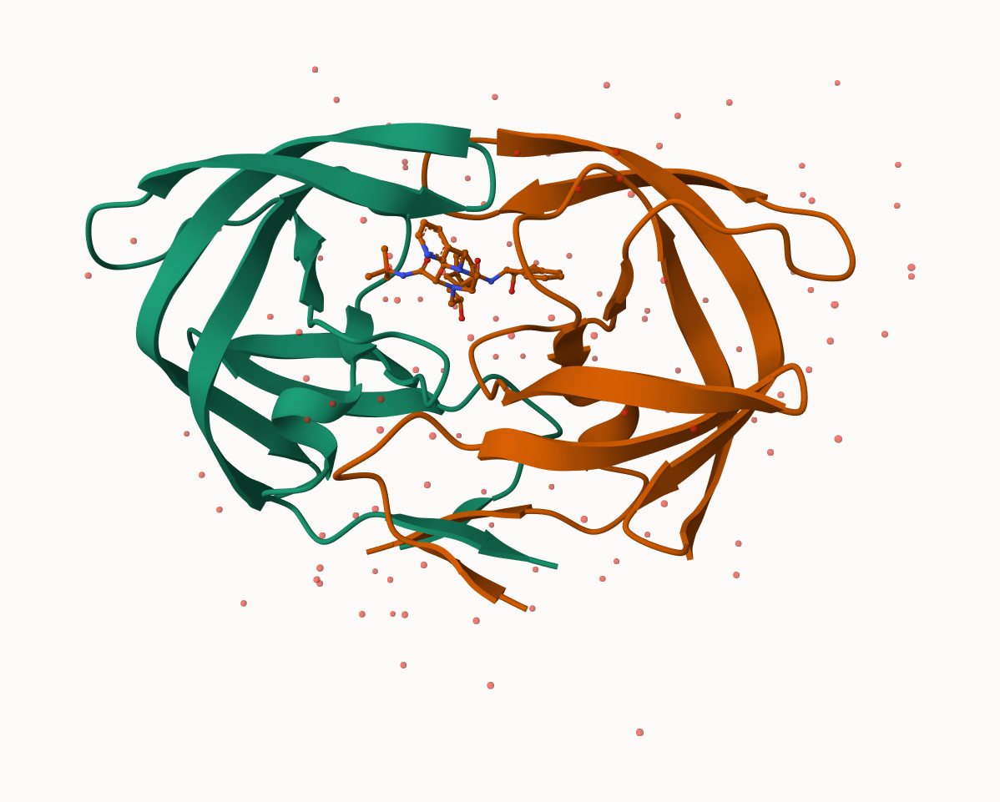

## Background

The \[PDB database\] is the main repository of biomolecular structure information. Let's have a look at the composition of this database:

Visit PDB and click: Analyze \> PDB Statistics \> Experimental Method \> Summary

We can "scape" data from this page with the **datapasta** that we can install from CRAN `install.packages("datapasta")`

```{r, echo=FALSE}
pdb <- data.frame(
  stringsAsFactors = FALSE,
       check.names = FALSE,
                Molecular.Type = c("Protein (only)","Protein/Oligosaccharide",
                                   "Protein/NA","Nucleic acid (only)","Other",
                                   "Oligosaccharide (only)","Total"),
                Xray = c(184731, 10716, 9341, 3216, 178, 11, 208193),
                EM = c(25754, 4037, 7520, 347, 27, 1, 37686),
               NMR = c(12904, 34, 288, 1599, 35, 6, 14866),
       Integrative = c(365L, 8L, 27L, 3L, 4L, 0L, 407L),
  Multiple.methods = c(232L, 11L, 8L, 15L, 0L, 1L, 267L),
           Neutron = c(86L, 1L, 0L, 3L, 0L, 0L, 90L),
             Other = c(32L, 0L, 0L, 1L, 0L, 4L, 37L),
             Total = c(224104, 14807, 17184, 5184, 244, 23, 261546)
            )
```

```{r}
read.csv("pdb_stats.csv")
```

> **Q1:** What percentage of structures in the PDB are solved by X-Ray and Electron Microscopy.

```{r}

library(dplyr)
pdb %>%
  summarize(xray_percent = sum(Xray) / sum(Total) * 100,
            em_percent   = sum(EM)    / sum(Total) * 100)

# or

(sum(pdb$Xray) / sum(pdb$Total)) * 100
(sum(pdb$EM) / sum(pdb$Total)) * 100
```

> **Q2:** What proportion of structures in the PDB are protein?

```{r}

pdb$Total[1] / pdb$Total[7]

```

> **Q3:** Type HIV in the PDB website search box on the home page and determine how many HIV-1 protease structures are in the current PDB?

A: 5128 structures (if I search HIV); 1198 structures (if I search HIV-1 protease)

## 3. The Mol-star (Mol\*) Viewer

This viewer is embedded into many newer bioinformatics databases, including the PDB and UniProt. The viewer is also accessible from its homepage: https://molstar.org



HIV-Protease (or HIV-Pr) is a critical HIV enzyme required for virus replication. It is an Aspartal protease which means it use Asp amino acid residues to cleave viral proteins.


> Q4: Water molecules normally have 3 atoms. Why do we see just one atom per water molecule in this structure?

A: X-ray crystallography detects electrons, and hydrogen has only one electron, so it scatters X-rays very weakly. At the given resolution (2 Å), the hydrogen atoms can’t be seen, so only the oxygen atom of each water molecule is modeled and displayed.

> Q5: There is a critical “conserved” water molecule in the binding site. Can you identify this water molecule? What residue number does this water molecule have?

A: HOH 308

> Q6: Generate and save a figure clearly showing the two distinct chains of HIV-protease along with the ligand. You might also consider showing the catalytic residues ASP 25 in each chain and the critical water (we recommend “Ball & Stick” for these side-chains). Add this figure to your Quarto document.

A: 

Discussion Topic: Can you think of a way in which indinavir, or even larger ligands and substrates, could enter the binding site?

> Q7: \[Optional\] As you have hopefully observed HIV protease is a homodimer (i.e. it is composed of two identical chains). With the aid of the graphic display can you identify secondary structure elements that are likely to only form in the dimer rather than the monomer?

## 4. Bio3D in R

The **bio3d** package us foe structural bioinformatics and allows us to reead structural data and perform bioinformatics analysis all within R itself:

```{r}
library(bio3d)

hiv <- read.pdb("1hsg")
```

```{r}
hiv
```

```{r}
head(hiv$atom)
```

> Q7: How many amino acid residues are there in this pdb object?

```{r}
length(pdbseq(hiv))
```

A: There are 198 amino acid residues.

> Q8: Name one of the two non-protein residues?

A: MK (1)

> Q9: How many protein chains are in this structure?

```{r}
pdbseq(hiv)
```

A: There are **2 protein chains** in this structure.

## Quick PDB visualization in R

```{r}
library(bio3dview)
library(NGLVieweR)
```

```{r}
view.pdb(hiv) |>
  setSpin()
```

```{r}
# Select our two ASP 25 amino acids
asp <- atom.select(hiv, resno=25)

# Draw them highlighted in spacefill
view.pdb(hiv,
         highlight = asp,
         highlight.style = "spacefill") |>
  setRock()
```

## Predict the dynamics of ADK adenylyl kinase

```{r}
adk <- read.pdb("6s36")
m <- nma(adk)
plot(m)
```

Also, make a little molecular movie (trajectory) for view in Mol-star

```{r}
mktrj(m, file="adk_dynamics.pdb")
```

```{r}
view.nma(m)
```

## 5. Comparative Structure Analysis of Andenylate Kinase

```{r}
# Install packages in the R console NOT your Rmd/Quarto file

# install.packages("bio3d")
# install.packages("NGLVieweR")

# install.packages("remotes")
# remotes::install_github("bioboot/bio3dview")

# install.packages("BiocManager")
# BiocManager::install("msa")
```

> **Q10.** Which of the packages above is found only on BioConductor and not CRAN?

A: msa

> **Q11.** Which of the above packages is not found on BioConductor or CRAN?

A: bio3dview

> **Q12.** True or False? Functions from the pak package can be used to install packages from GitHub and BitBucket?

A: True

### Search and retrieve ADK structures

```{r}
library(bio3d)
aa <- get.seq("1ake_A")
```

```{r}
aa
```

>**Q13.** How many amino acids are in this sequence, i.e. how long is this sequence?

```{r}
ncol(aa$ali)
```
A: 214

```{r}
hits <- NULL
hits$pdb.id <- c('1AKE_A','6S36_A','6RZE_A','3HPR_A','1E4V_A','5EJE_A','1E4Y_A','3X2S_A','6HAP_A','6HAM_A','4K46_A','3GMT_A','4PZL_A')
```

```{r}
# Download releated PDB files
files <- get.pdb(hits$pdb.id, path="pdbs", split=TRUE, gzip=TRUE)
```
```{r}
# Align releated PDBs
pdbs <- pdbaln(files, fit = TRUE, exefile="msa")
```

```{r}
library(bio3dview)
view.pdbs(pdbs)
```

