# Class11_AlphaFold
Joaquin Jalova Arig

- [Background](#background)
- [1. HIV-PR Monomer](#1-hiv-pr-monomer)
  - [Read the AF models](#read-the-af-models)
  - [RMSD](#rmsd)
  - [RMSF](#rmsf)
  - [Residue Conservation](#residue-conservation)
  - [AF scores (pLDDT & PAE score
    plots)](#af-scores-plddt--pae-score-plots)
- [2. HIV-PR Dimer](#2-hiv-pr-dimer)
  - [Read the AF models](#read-the-af-models-1)
  - [RMSD](#rmsd-1)
  - [RMSF](#rmsf-1)
  - [Residue Conservation](#residue-conservation-1)
  - [AF scores (pLDDT & PAE score
    plots)](#af-scores-plddt--pae-score-plots-1)
- [3. My. Find-A-Gene Sequence](#3-my-find-a-gene-sequence)
  - [Read the AF model](#read-the-af-model)
  - [RMSD](#rmsd-2)
  - [RMSF](#rmsf-2)
  - [Residue Conservation](#residue-conservation-2)
  - [AF scores (pLDDT & PAE score
    plots)](#af-scores-plddt--pae-score-plots-2)

``` r
library(bio3d)
library(msa)
```

    Loading required package: Biostrings

    Loading required package: BiocGenerics

    Loading required package: generics

    Attaching package: 'generics'

    The following objects are masked from 'package:base':

        as.difftime, as.factor, as.ordered, intersect, is.element, setdiff,
        setequal, union

    Attaching package: 'BiocGenerics'

    The following objects are masked from 'package:stats':

        IQR, mad, sd, var, xtabs

    The following objects are masked from 'package:base':

        anyDuplicated, aperm, append, as.data.frame, basename, cbind,
        colnames, dirname, do.call, duplicated, eval, evalq, Filter, Find,
        get, grep, grepl, is.unsorted, lapply, Map, mapply, match, mget,
        order, paste, pmax, pmax.int, pmin, pmin.int, Position, rank,
        rbind, Reduce, rownames, sapply, saveRDS, table, tapply, unique,
        unsplit, which.max, which.min

    Loading required package: S4Vectors

    Loading required package: stats4

    Attaching package: 'S4Vectors'

    The following object is masked from 'package:utils':

        findMatches

    The following objects are masked from 'package:base':

        expand.grid, I, unname

    Loading required package: IRanges

    Attaching package: 'IRanges'

    The following object is masked from 'package:bio3d':

        trim

    Loading required package: XVector

    Loading required package: Seqinfo

    Attaching package: 'Biostrings'

    The following object is masked from 'package:bio3d':

        mask

    The following object is masked from 'package:base':

        strsplit

## Background

We ran 3 AlphaFold2 predictions,

- HIV-PR_monomer
- HIV-PR_dimer
- My find-a-gene protein sequence

Here we analyze the resulting models and make some diagnostic plots that
inform on model reliability

## 1. HIV-PR Monomer

### Read the AF models

``` r
list.files(path="HIV_monomer_94b5b/",
           full.names = F,
           pattern = ".pdb")
```

    [1] "HIV_monomer_94b5b_unrelaxed_rank_001_alphafold2_ptm_model_4_seed_000.pdb"
    [2] "HIV_monomer_94b5b_unrelaxed_rank_002_alphafold2_ptm_model_5_seed_000.pdb"
    [3] "HIV_monomer_94b5b_unrelaxed_rank_003_alphafold2_ptm_model_3_seed_000.pdb"
    [4] "HIV_monomer_94b5b_unrelaxed_rank_004_alphafold2_ptm_model_2_seed_000.pdb"
    [5] "HIV_monomer_94b5b_unrelaxed_rank_005_alphafold2_ptm_model_1_seed_000.pdb"

``` r
pdb_files <- list.files(path="HIV_monomer_94b5b/",
           full.names = T,
           pattern = ".pdb")
```

``` r
library(bio3d)
pdbs <- pdbaln(pdb_files, fit=TRUE, exefile = "msa")
```

    Reading PDB files:
    HIV_monomer_94b5b//HIV_monomer_94b5b_unrelaxed_rank_001_alphafold2_ptm_model_4_seed_000.pdb
    HIV_monomer_94b5b//HIV_monomer_94b5b_unrelaxed_rank_002_alphafold2_ptm_model_5_seed_000.pdb
    HIV_monomer_94b5b//HIV_monomer_94b5b_unrelaxed_rank_003_alphafold2_ptm_model_3_seed_000.pdb
    HIV_monomer_94b5b//HIV_monomer_94b5b_unrelaxed_rank_004_alphafold2_ptm_model_2_seed_000.pdb
    HIV_monomer_94b5b//HIV_monomer_94b5b_unrelaxed_rank_005_alphafold2_ptm_model_1_seed_000.pdb
    .....

    Extracting sequences

    pdb/seq: 1   name: HIV_monomer_94b5b//HIV_monomer_94b5b_unrelaxed_rank_001_alphafold2_ptm_model_4_seed_000.pdb 
    pdb/seq: 2   name: HIV_monomer_94b5b//HIV_monomer_94b5b_unrelaxed_rank_002_alphafold2_ptm_model_5_seed_000.pdb 
    pdb/seq: 3   name: HIV_monomer_94b5b//HIV_monomer_94b5b_unrelaxed_rank_003_alphafold2_ptm_model_3_seed_000.pdb 
    pdb/seq: 4   name: HIV_monomer_94b5b//HIV_monomer_94b5b_unrelaxed_rank_004_alphafold2_ptm_model_2_seed_000.pdb 
    pdb/seq: 5   name: HIV_monomer_94b5b//HIV_monomer_94b5b_unrelaxed_rank_005_alphafold2_ptm_model_1_seed_000.pdb 

``` r
pdbs
```

                                   1        .         .         .         .         50 
    [Truncated_Name:1]HIV_monome   PQITLWQRPLVTIKIGGQLKEALLDTGADDTVLEEMSLPGRWKPKMIGGI
    [Truncated_Name:2]HIV_monome   PQITLWQRPLVTIKIGGQLKEALLDTGADDTVLEEMSLPGRWKPKMIGGI
    [Truncated_Name:3]HIV_monome   PQITLWQRPLVTIKIGGQLKEALLDTGADDTVLEEMSLPGRWKPKMIGGI
    [Truncated_Name:4]HIV_monome   PQITLWQRPLVTIKIGGQLKEALLDTGADDTVLEEMSLPGRWKPKMIGGI
    [Truncated_Name:5]HIV_monome   PQITLWQRPLVTIKIGGQLKEALLDTGADDTVLEEMSLPGRWKPKMIGGI
                                   ************************************************** 
                                   1        .         .         .         .         50 

                                  51        .         .         .         .        99 
    [Truncated_Name:1]HIV_monome   GGFIKVRQYDQILIEICGHKAIGTVLVGPTPVNIIGRNLLTQIGCTLNF
    [Truncated_Name:2]HIV_monome   GGFIKVRQYDQILIEICGHKAIGTVLVGPTPVNIIGRNLLTQIGCTLNF
    [Truncated_Name:3]HIV_monome   GGFIKVRQYDQILIEICGHKAIGTVLVGPTPVNIIGRNLLTQIGCTLNF
    [Truncated_Name:4]HIV_monome   GGFIKVRQYDQILIEICGHKAIGTVLVGPTPVNIIGRNLLTQIGCTLNF
    [Truncated_Name:5]HIV_monome   GGFIKVRQYDQILIEICGHKAIGTVLVGPTPVNIIGRNLLTQIGCTLNF
                                   ************************************************* 
                                  51        .         .         .         .        99 

    Call:
      pdbaln(files = pdb_files, fit = TRUE, exefile = "msa")

    Class:
      pdbs, fasta

    Alignment dimensions:
      5 sequence rows; 99 position columns (99 non-gap, 0 gap) 

    + attr: xyz, resno, b, chain, id, ali, resid, sse, call

### RMSD

``` r
rd <- rmsd(pdbs, fit=T)
```

    Warning in rmsd(pdbs, fit = T): No indices provided, using the 99 non NA positions

``` r
range(rd)
```

    [1] 0.000 1.238

``` r
library(pheatmap)

colnames(rd) <- paste0("m",1:5)
rownames(rd) <- paste0("m",1:5)
pheatmap(rd)
```

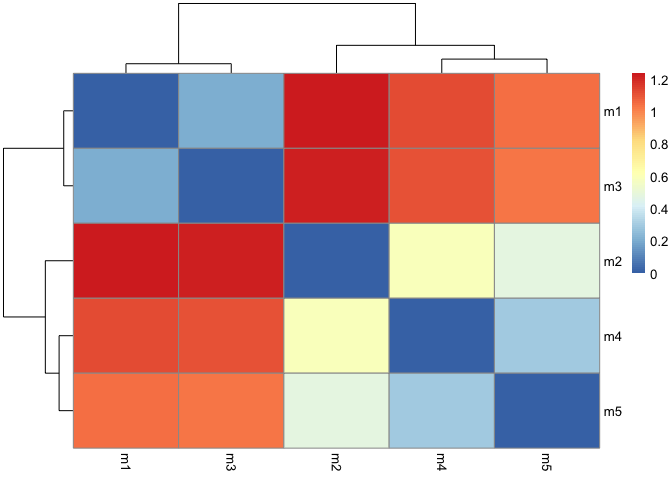

### RMSF

``` r
rf <- rmsf(pdbs$xyz)
plot.bio3d(rf)
```

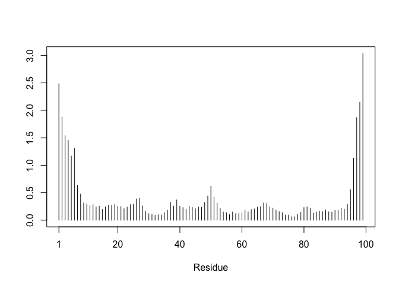

### Residue Conservation

Read the AF MSA

``` r
aln_file <- list.files(path="HIV_monomer_94b5b/",
                       pattern=".a3m$",
                        full.names = TRUE)
aln_file
```

    [1] "HIV_monomer_94b5b//HIV_monomer_94b5b.a3m"

``` r
aln <- read.fasta(aln_file[1], to.upper = TRUE)
```

    [1] " ** Duplicated sequence id's: 101 **"

We can score residue. conservation in the alignment with the conserv()
function.

``` r
sim <- conserv(aln)
```

Plot this conservation result

``` r
plot(sim, typ = "h")
```

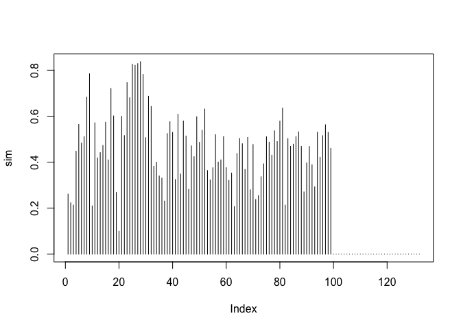

``` r
con <- consensus (aln, cutoff = 0.88)
con$seq
```

      [1] "-" "-" "-" "-" "-" "-" "-" "-" "P" "-" "-" "-" "-" "-" "-" "-" "-" "-"
     [19] "-" "-" "-" "-" "-" "-" "D" "T" "G" "A" "D" "-" "-" "-" "-" "-" "-" "-"
     [37] "-" "-" "-" "-" "-" "-" "-" "-" "-" "-" "-" "-" "-" "-" "-" "-" "-" "-"
     [55] "-" "-" "-" "-" "-" "-" "-" "-" "-" "-" "-" "-" "-" "-" "-" "-" "-" "-"
     [73] "-" "-" "-" "-" "-" "-" "-" "-" "-" "-" "-" "-" "-" "-" "-" "-" "-" "-"
     [91] "-" "-" "-" "-" "-" "-" "-" "-" "-" "-" "-" "-" "-" "-" "-" "-" "-" "-"
    [109] "-" "-" "-" "-" "-" "-" "-" "-" "-" "-" "-" "-" "-" "-" "-" "-" "-" "-"
    [127] "-" "-" "-" "-" "-" "-"

``` r
m1.pdb <- read.pdb(pdb_files[1])
occ <- vec2resno(sim[1:99], m1.pdb$atom$resno)
write.pdb(m1.pdb, o=occ, file="m1_conserv.pdb")
occ
```

      [1] 0.26128929 0.26128929 0.26128929 0.26128929 0.26128929 0.26128929
      [7] 0.26128929 0.22339214 0.22339214 0.22339214 0.22339214 0.22339214
     [13] 0.22339214 0.22339214 0.22339214 0.22339214 0.21353374 0.21353374
     [19] 0.21353374 0.21353374 0.21353374 0.21353374 0.21353374 0.21353374
     [25] 0.44761715 0.44761715 0.44761715 0.44761715 0.44761715 0.44761715
     [31] 0.44761715 0.56416064 0.56416064 0.56416064 0.56416064 0.56416064
     [37] 0.56416064 0.56416064 0.56416064 0.48299769 0.48299769 0.48299769
     [43] 0.48299769 0.48299769 0.48299769 0.48299769 0.48299769 0.48299769
     [49] 0.48299769 0.48299769 0.48299769 0.48299769 0.48299769 0.51100684
     [55] 0.51100684 0.51100684 0.51100684 0.51100684 0.51100684 0.51100684
     [61] 0.51100684 0.51100684 0.68297314 0.68297314 0.68297314 0.68297314
     [67] 0.68297314 0.68297314 0.68297314 0.68297314 0.68297314 0.68297314
     [73] 0.68297314 0.78445940 0.78445940 0.78445940 0.78445940 0.78445940
     [79] 0.78445940 0.78445940 0.20968057 0.20968057 0.20968057 0.20968057
     [85] 0.20968057 0.20968057 0.20968057 0.20968057 0.57133125 0.57133125
     [91] 0.57133125 0.57133125 0.57133125 0.57133125 0.57133125 0.41860265
     [97] 0.41860265 0.41860265 0.41860265 0.41860265 0.41860265 0.41860265
    [103] 0.44149955 0.44149955 0.44149955 0.44149955 0.44149955 0.44149955
    [109] 0.44149955 0.44149955 0.47274519 0.47274519 0.47274519 0.47274519
    [115] 0.47274519 0.47274519 0.47274519 0.47274519 0.47274519 0.57365511
    [121] 0.57365511 0.57365511 0.57365511 0.57365511 0.57365511 0.57365511
    [127] 0.57365511 0.40994173 0.40994173 0.40994173 0.40994173 0.72035431
    [133] 0.72035431 0.72035431 0.72035431 0.60115250 0.60115250 0.60115250
    [139] 0.60115250 0.60115250 0.60115250 0.60115250 0.60115250 0.60115250
    [145] 0.26857327 0.26857327 0.26857327 0.26857327 0.26857327 0.26857327
    [151] 0.26857327 0.26857327 0.09989757 0.09989757 0.09989757 0.09989757
    [157] 0.09989757 0.09989757 0.09989757 0.09989757 0.09989757 0.59930747
    [163] 0.59930747 0.59930747 0.59930747 0.59930747 0.59930747 0.59930747
    [169] 0.59930747 0.59930747 0.51562436 0.51562436 0.51562436 0.51562436
    [175] 0.51562436 0.74610101 0.74610101 0.74610101 0.74610101 0.74610101
    [181] 0.74610101 0.74610101 0.74610101 0.67995507 0.67995507 0.67995507
    [187] 0.67995507 0.67995507 0.67995507 0.67995507 0.67995507 0.82541629
    [193] 0.82541629 0.82541629 0.82541629 0.82541629 0.82541629 0.82541629
    [199] 0.82541629 0.82109744 0.82109744 0.82109744 0.82109744 0.82109744
    [205] 0.82109744 0.82109744 0.82852210 0.82852210 0.82852210 0.82852210
    [211] 0.83701474 0.83701474 0.83701474 0.83701474 0.83701474 0.78135377
    [217] 0.78135377 0.78135377 0.78135377 0.78135377 0.78135377 0.78135377
    [223] 0.78135377 0.50655184 0.50655184 0.50655184 0.50655184 0.50655184
    [229] 0.50655184 0.50655184 0.50655184 0.68670119 0.68670119 0.68670119
    [235] 0.68670119 0.68670119 0.68670119 0.68670119 0.64225626 0.64225626
    [241] 0.64225626 0.64225626 0.64225626 0.64225626 0.64225626 0.38263062
    [247] 0.38263062 0.38263062 0.38263062 0.38263062 0.38263062 0.38263062
    [253] 0.38263062 0.39933473 0.39933473 0.39933473 0.39933473 0.39933473
    [259] 0.39933473 0.39933473 0.39933473 0.39933473 0.34001288 0.34001288
    [265] 0.34001288 0.34001288 0.34001288 0.34001288 0.34001288 0.34001288
    [271] 0.34001288 0.33081840 0.33081840 0.33081840 0.33081840 0.33081840
    [277] 0.33081840 0.33081840 0.33081840 0.23103234 0.23103234 0.23103234
    [283] 0.23103234 0.23103234 0.23103234 0.52432862 0.52432862 0.52432862
    [289] 0.52432862 0.52432862 0.52432862 0.52432862 0.52432862 0.57618677
    [295] 0.57618677 0.57618677 0.57618677 0.57618677 0.57618677 0.57618677
    [301] 0.52958249 0.52958249 0.52958249 0.52958249 0.32439120 0.32439120
    [307] 0.32439120 0.32439120 0.32439120 0.32439120 0.32439120 0.32439120
    [313] 0.32439120 0.32439120 0.32439120 0.60835220 0.60835220 0.60835220
    [319] 0.60835220 0.60835220 0.60835220 0.60835220 0.60835220 0.60835220
    [325] 0.60835220 0.60835220 0.60835220 0.60835220 0.60835220 0.34843230
    [331] 0.34843230 0.34843230 0.34843230 0.34843230 0.34843230 0.34843230
    [337] 0.34843230 0.34843230 0.57921772 0.57921772 0.57921772 0.57921772
    [343] 0.57921772 0.57921772 0.57921772 0.51396639 0.51396639 0.51396639
    [349] 0.51396639 0.51396639 0.51396639 0.51396639 0.51396639 0.51396639
    [355] 0.28180739 0.28180739 0.28180739 0.28180739 0.28180739 0.28180739
    [361] 0.28180739 0.28180739 0.47088506 0.47088506 0.47088506 0.47088506
    [367] 0.47088506 0.47088506 0.47088506 0.47088506 0.42372477 0.42372477
    [373] 0.42372477 0.42372477 0.59754075 0.59754075 0.59754075 0.59754075
    [379] 0.48620085 0.48620085 0.48620085 0.48620085 0.48620085 0.48620085
    [385] 0.48620085 0.48620085 0.53889345 0.53889345 0.53889345 0.53889345
    [391] 0.63107244 0.63107244 0.63107244 0.63107244 0.36351197 0.36351197
    [397] 0.36351197 0.36351197 0.36351197 0.36351197 0.36351197 0.36351197
    [403] 0.36351197 0.36351197 0.36351197 0.32308575 0.32308575 0.32308575
    [409] 0.32308575 0.32308575 0.32308575 0.32308575 0.32308575 0.37574267
    [415] 0.37574267 0.37574267 0.37574267 0.37574267 0.37574267 0.37574267
    [421] 0.37574267 0.37574267 0.51962169 0.51962169 0.51962169 0.51962169
    [427] 0.51962169 0.51962169 0.51962169 0.40069594 0.40069594 0.40069594
    [433] 0.40069594 0.40069594 0.40069594 0.40069594 0.40069594 0.40069594
    [439] 0.40069594 0.40069594 0.41000684 0.41000684 0.41000684 0.41000684
    [445] 0.41000684 0.41000684 0.41000684 0.41000684 0.41000684 0.51115910
    [451] 0.51115910 0.51115910 0.51115910 0.51115910 0.51115910 0.51115910
    [457] 0.51115910 0.51115910 0.51115910 0.51115910 0.51115910 0.37607428
    [463] 0.37607428 0.37607428 0.37607428 0.37607428 0.37607428 0.37607428
    [469] 0.37607428 0.32119462 0.32119462 0.32119462 0.32119462 0.32119462
    [475] 0.32119462 0.32119462 0.32119462 0.32119462 0.35281590 0.35281590
    [481] 0.35281590 0.35281590 0.35281590 0.35281590 0.35281590 0.35281590
    [487] 0.20654137 0.20654137 0.20654137 0.20654137 0.20654137 0.20654137
    [493] 0.20654137 0.20654137 0.43777458 0.43777458 0.43777458 0.43777458
    [499] 0.43777458 0.43777458 0.43777458 0.43777458 0.50320855 0.50320855
    [505] 0.50320855 0.50320855 0.50320855 0.50320855 0.50320855 0.50320855
    [511] 0.50320855 0.48013437 0.48013437 0.48013437 0.48013437 0.48013437
    [517] 0.48013437 0.48013437 0.48013437 0.36846126 0.36846126 0.36846126
    [523] 0.36846126 0.36846126 0.36846126 0.50785636 0.50785636 0.50785636
    [529] 0.50785636 0.27973793 0.27973793 0.27973793 0.27973793 0.27973793
    [535] 0.27973793 0.27973793 0.27973793 0.27973793 0.27973793 0.47674278
    [541] 0.47674278 0.47674278 0.47674278 0.47674278 0.47674278 0.47674278
    [547] 0.47674278 0.47674278 0.23782774 0.23782774 0.23782774 0.23782774
    [553] 0.23782774 0.25448952 0.25448952 0.25448952 0.25448952 0.25448952
    [559] 0.25448952 0.25448952 0.25448952 0.33651570 0.33651570 0.33651570
    [565] 0.33651570 0.39266225 0.39266225 0.39266225 0.39266225 0.39266225
    [571] 0.39266225 0.39266225 0.51038953 0.51038953 0.51038953 0.51038953
    [577] 0.51038953 0.51038953 0.51038953 0.48696080 0.48696080 0.48696080
    [583] 0.48696080 0.48696080 0.48696080 0.48696080 0.48696080 0.43030474
    [589] 0.43030474 0.43030474 0.43030474 0.43030474 0.43030474 0.43030474
    [595] 0.53635399 0.53635399 0.53635399 0.53635399 0.48952022 0.48952022
    [601] 0.48952022 0.48952022 0.48952022 0.48952022 0.48952022 0.57888827
    [607] 0.57888827 0.57888827 0.57888827 0.57888827 0.57888827 0.57888827
    [613] 0.63533286 0.63533286 0.63533286 0.63533286 0.63533286 0.63533286
    [619] 0.63533286 0.21346382 0.21346382 0.21346382 0.21346382 0.21346382
    [625] 0.21346382 0.21346382 0.50249197 0.50249197 0.50249197 0.50249197
    [631] 0.50249197 0.50249197 0.50249197 0.50249197 0.46884781 0.46884781
    [637] 0.46884781 0.46884781 0.46884781 0.46884781 0.46884781 0.46884781
    [643] 0.47828347 0.47828347 0.47828347 0.47828347 0.47828347 0.47828347
    [649] 0.47828347 0.47828347 0.51111938 0.51111938 0.51111938 0.51111938
    [655] 0.53177263 0.53177263 0.53177263 0.53177263 0.53177263 0.53177263
    [661] 0.53177263 0.53177263 0.53177263 0.53177263 0.53177263 0.46857361
    [667] 0.46857361 0.46857361 0.46857361 0.46857361 0.46857361 0.46857361
    [673] 0.46857361 0.27075677 0.27075677 0.27075677 0.27075677 0.27075677
    [679] 0.27075677 0.27075677 0.27075677 0.39629207 0.39629207 0.39629207
    [685] 0.39629207 0.39629207 0.39629207 0.39629207 0.39629207 0.46818334
    [691] 0.46818334 0.46818334 0.46818334 0.46818334 0.46818334 0.46818334
    [697] 0.38879349 0.38879349 0.38879349 0.38879349 0.38879349 0.38879349
    [703] 0.38879349 0.38879349 0.38879349 0.29260745 0.29260745 0.29260745
    [709] 0.29260745 0.29260745 0.29260745 0.29260745 0.29260745 0.53040514
    [715] 0.53040514 0.53040514 0.53040514 0.42120030 0.42120030 0.42120030
    [721] 0.42120030 0.42120030 0.42120030 0.51520793 0.51520793 0.51520793
    [727] 0.51520793 0.51520793 0.51520793 0.51520793 0.56261009 0.56261009
    [733] 0.56261009 0.56261009 0.56261009 0.56261009 0.56261009 0.56261009
    [739] 0.52944158 0.52944158 0.52944158 0.52944158 0.52944158 0.52944158
    [745] 0.52944158 0.52944158 0.46037646 0.46037646 0.46037646 0.46037646
    [751] 0.46037646 0.46037646 0.46037646 0.46037646 0.46037646 0.46037646
    [757] 0.46037646

### AF scores (pLDDT & PAE score plots)

The pLDDT scores are stored in the PDB models “B-factor” col and in a
separate JSON format file in the results directory. We can use either:

``` r
plotb3(pdbs$b[1,], type="l", lwd=2)
points(pdbs$b[2,], typ="l", col="red")
points(pdbs$b[3,], typ="l", col="blue")
points(pdbs$b[4,], typ="l", col="darkgreen")
points(pdbs$b[5,], typ="l", col="orange")
abline(v=100, col="gray")
```

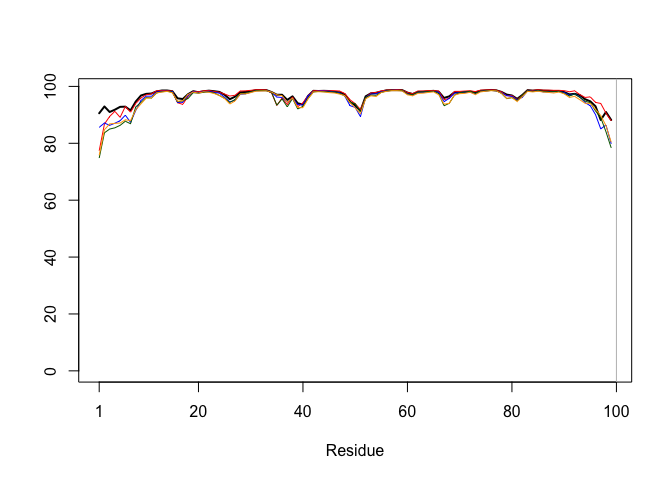

``` r
# Plot m1.pdb$atom$b[m1.pdb$calpha], type = "h"
```

## 2. HIV-PR Dimer

### Read the AF models

``` r
list.files(path="HIV_dimer_23119/",
           full.names = F,
           pattern = ".pdb")
```

    [1] "HIV_dimer_23119_unrelaxed_rank_001_alphafold2_multimer_v3_model_4_seed_000.pdb"
    [2] "HIV_dimer_23119_unrelaxed_rank_002_alphafold2_multimer_v3_model_1_seed_000.pdb"
    [3] "HIV_dimer_23119_unrelaxed_rank_003_alphafold2_multimer_v3_model_5_seed_000.pdb"
    [4] "HIV_dimer_23119_unrelaxed_rank_004_alphafold2_multimer_v3_model_2_seed_000.pdb"
    [5] "HIV_dimer_23119_unrelaxed_rank_005_alphafold2_multimer_v3_model_3_seed_000.pdb"

``` r
pdb_files2 <- list.files(path="HIV_dimer_23119/",
           full.names = T,
           pattern = ".pdb")
```

``` r
library(bio3d)
pdbs2 <- pdbaln(pdb_files2, fit=TRUE, exefile = "msa")
```

    Reading PDB files:
    HIV_dimer_23119//HIV_dimer_23119_unrelaxed_rank_001_alphafold2_multimer_v3_model_4_seed_000.pdb
    HIV_dimer_23119//HIV_dimer_23119_unrelaxed_rank_002_alphafold2_multimer_v3_model_1_seed_000.pdb
    HIV_dimer_23119//HIV_dimer_23119_unrelaxed_rank_003_alphafold2_multimer_v3_model_5_seed_000.pdb
    HIV_dimer_23119//HIV_dimer_23119_unrelaxed_rank_004_alphafold2_multimer_v3_model_2_seed_000.pdb
    HIV_dimer_23119//HIV_dimer_23119_unrelaxed_rank_005_alphafold2_multimer_v3_model_3_seed_000.pdb
    .....

    Extracting sequences

    pdb/seq: 1   name: HIV_dimer_23119//HIV_dimer_23119_unrelaxed_rank_001_alphafold2_multimer_v3_model_4_seed_000.pdb 
    pdb/seq: 2   name: HIV_dimer_23119//HIV_dimer_23119_unrelaxed_rank_002_alphafold2_multimer_v3_model_1_seed_000.pdb 
    pdb/seq: 3   name: HIV_dimer_23119//HIV_dimer_23119_unrelaxed_rank_003_alphafold2_multimer_v3_model_5_seed_000.pdb 
    pdb/seq: 4   name: HIV_dimer_23119//HIV_dimer_23119_unrelaxed_rank_004_alphafold2_multimer_v3_model_2_seed_000.pdb 
    pdb/seq: 5   name: HIV_dimer_23119//HIV_dimer_23119_unrelaxed_rank_005_alphafold2_multimer_v3_model_3_seed_000.pdb 

``` r
pdbs2
```

                                   1        .         .         .         .         50 
    [Truncated_Name:1]HIV_dimer_   PQITLWQRPLVTIKIGGQLKEALLDTGADDTVLEEMSLPGRWKPKMIGGI
    [Truncated_Name:2]HIV_dimer_   PQITLWQRPLVTIKIGGQLKEALLDTGADDTVLEEMSLPGRWKPKMIGGI
    [Truncated_Name:3]HIV_dimer_   PQITLWQRPLVTIKIGGQLKEALLDTGADDTVLEEMSLPGRWKPKMIGGI
    [Truncated_Name:4]HIV_dimer_   PQITLWQRPLVTIKIGGQLKEALLDTGADDTVLEEMSLPGRWKPKMIGGI
    [Truncated_Name:5]HIV_dimer_   PQITLWQRPLVTIKIGGQLKEALLDTGADDTVLEEMSLPGRWKPKMIGGI
                                   ************************************************** 
                                   1        .         .         .         .         50 

                                  51        .         .         .         .         100 
    [Truncated_Name:1]HIV_dimer_   GGFIKVRQYDQILIEICGHKAIGTVLVGPTPVNIIGRNLLTQIGCTLNFP
    [Truncated_Name:2]HIV_dimer_   GGFIKVRQYDQILIEICGHKAIGTVLVGPTPVNIIGRNLLTQIGCTLNFP
    [Truncated_Name:3]HIV_dimer_   GGFIKVRQYDQILIEICGHKAIGTVLVGPTPVNIIGRNLLTQIGCTLNFP
    [Truncated_Name:4]HIV_dimer_   GGFIKVRQYDQILIEICGHKAIGTVLVGPTPVNIIGRNLLTQIGCTLNFP
    [Truncated_Name:5]HIV_dimer_   GGFIKVRQYDQILIEICGHKAIGTVLVGPTPVNIIGRNLLTQIGCTLNFP
                                   ************************************************** 
                                  51        .         .         .         .         100 

                                 101        .         .         .         .         150 
    [Truncated_Name:1]HIV_dimer_   QITLWQRPLVTIKIGGQLKEALLDTGADDTVLEEMSLPGRWKPKMIGGIG
    [Truncated_Name:2]HIV_dimer_   QITLWQRPLVTIKIGGQLKEALLDTGADDTVLEEMSLPGRWKPKMIGGIG
    [Truncated_Name:3]HIV_dimer_   QITLWQRPLVTIKIGGQLKEALLDTGADDTVLEEMSLPGRWKPKMIGGIG
    [Truncated_Name:4]HIV_dimer_   QITLWQRPLVTIKIGGQLKEALLDTGADDTVLEEMSLPGRWKPKMIGGIG
    [Truncated_Name:5]HIV_dimer_   QITLWQRPLVTIKIGGQLKEALLDTGADDTVLEEMSLPGRWKPKMIGGIG
                                   ************************************************** 
                                 101        .         .         .         .         150 

                                 151        .         .         .         .       198 
    [Truncated_Name:1]HIV_dimer_   GFIKVRQYDQILIEICGHKAIGTVLVGPTPVNIIGRNLLTQIGCTLNF
    [Truncated_Name:2]HIV_dimer_   GFIKVRQYDQILIEICGHKAIGTVLVGPTPVNIIGRNLLTQIGCTLNF
    [Truncated_Name:3]HIV_dimer_   GFIKVRQYDQILIEICGHKAIGTVLVGPTPVNIIGRNLLTQIGCTLNF
    [Truncated_Name:4]HIV_dimer_   GFIKVRQYDQILIEICGHKAIGTVLVGPTPVNIIGRNLLTQIGCTLNF
    [Truncated_Name:5]HIV_dimer_   GFIKVRQYDQILIEICGHKAIGTVLVGPTPVNIIGRNLLTQIGCTLNF
                                   ************************************************ 
                                 151        .         .         .         .       198 

    Call:
      pdbaln(files = pdb_files2, fit = TRUE, exefile = "msa")

    Class:
      pdbs, fasta

    Alignment dimensions:
      5 sequence rows; 198 position columns (198 non-gap, 0 gap) 

    + attr: xyz, resno, b, chain, id, ali, resid, sse, call

### RMSD

``` r
rd2 <- rmsd(pdbs2, fit=T)
```

    Warning in rmsd(pdbs2, fit = T): No indices provided, using the 198 non NA positions

``` r
range(rd2)
```

    [1]  0.000 13.941

``` r
library(pheatmap)

colnames(rd2) <- paste0("m",1:5)
rownames(rd2) <- paste0("m",1:5)
pheatmap(rd2)
```

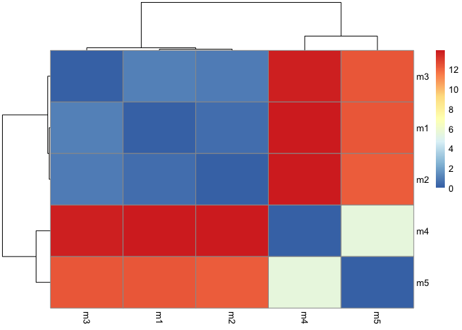

### RMSF

``` r
rf2 <- rmsf(pdbs2$xyz)
plot.bio3d(rf2)
```

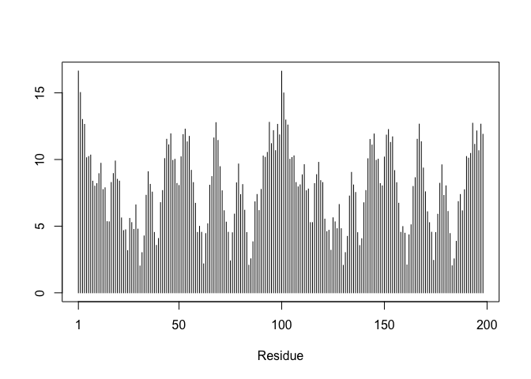

### Residue Conservation

Read the AF MSA

``` r
aln_file2 <- list.files(path="HIV_dimer_23119/",
                       pattern=".a3m$",
                        full.names = TRUE)
aln_file2
```

    [1] "HIV_dimer_23119//HIV_dimer_23119.a3m"

``` r
aln2 <- read.fasta(aln_file2[1], to.upper = TRUE)
```

    [1] " ** Duplicated sequence id's: 101 **"
    [2] " ** Duplicated sequence id's: 101 **"

We can score residue. conservation in the alignment with the conserv()
function.

``` r
sim2 <- conserv(aln2)
```

Plot this conservation result

``` r
plot(sim2, typ = "h")
```

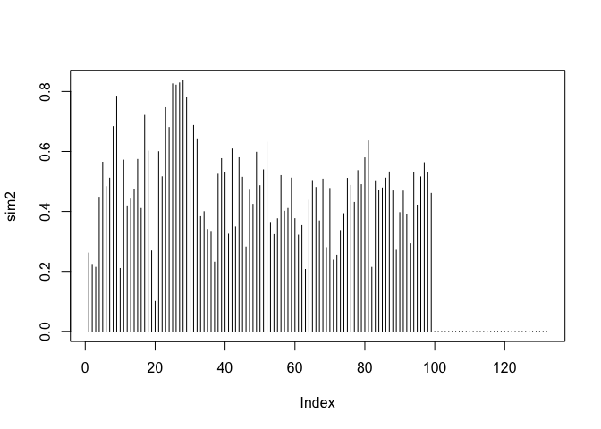

``` r
con2 <- consensus (aln2, cutoff = 0.88)
con2$seq
```

      [1] "-" "-" "-" "-" "-" "-" "-" "-" "P" "-" "-" "-" "-" "-" "-" "-" "-" "-"
     [19] "-" "-" "-" "-" "-" "-" "D" "T" "G" "A" "D" "-" "-" "-" "-" "-" "-" "-"
     [37] "-" "-" "-" "-" "-" "-" "-" "-" "-" "-" "-" "-" "-" "-" "-" "-" "-" "-"
     [55] "-" "-" "-" "-" "-" "-" "-" "-" "-" "-" "-" "-" "-" "-" "-" "-" "-" "-"
     [73] "-" "-" "-" "-" "-" "-" "-" "-" "-" "-" "-" "-" "-" "-" "-" "-" "-" "-"
     [91] "-" "-" "-" "-" "-" "-" "-" "-" "-" "-" "-" "-" "-" "-" "-" "-" "-" "-"
    [109] "-" "-" "-" "-" "-" "-" "-" "-" "-" "-" "-" "-" "-" "-" "-" "-" "-" "-"
    [127] "-" "-" "-" "-" "-" "-"

``` r
m2.pdb <- read.pdb(pdb_files2[1])
occ2 <- vec2resno(c(sim[1:99], sim[1:99]), m2.pdb$atom$resno)
write.pdb(m2.pdb, o = occ2, file = "m2_conserv.pdb")
length(occ2)   # 1514, one value per atom
```

    [1] 1514

``` r
head(occ2)
```

    [1] 0.2612893 0.2612893 0.2612893 0.2612893 0.2612893 0.2612893

### AF scores (pLDDT & PAE score plots)

The pLDDT scores are stored in the PDB models “B-factor” col and in a
separate JSON format file in the results directory. We can use either:

``` r
# Read and align the dimer models
pdbs2 <- pdbaln(pdb_files2, fit = TRUE, exefile = "msa")
```

    Reading PDB files:
    HIV_dimer_23119//HIV_dimer_23119_unrelaxed_rank_001_alphafold2_multimer_v3_model_4_seed_000.pdb
    HIV_dimer_23119//HIV_dimer_23119_unrelaxed_rank_002_alphafold2_multimer_v3_model_1_seed_000.pdb
    HIV_dimer_23119//HIV_dimer_23119_unrelaxed_rank_003_alphafold2_multimer_v3_model_5_seed_000.pdb
    HIV_dimer_23119//HIV_dimer_23119_unrelaxed_rank_004_alphafold2_multimer_v3_model_2_seed_000.pdb
    HIV_dimer_23119//HIV_dimer_23119_unrelaxed_rank_005_alphafold2_multimer_v3_model_3_seed_000.pdb
    .....

    Extracting sequences

    pdb/seq: 1   name: HIV_dimer_23119//HIV_dimer_23119_unrelaxed_rank_001_alphafold2_multimer_v3_model_4_seed_000.pdb 
    pdb/seq: 2   name: HIV_dimer_23119//HIV_dimer_23119_unrelaxed_rank_002_alphafold2_multimer_v3_model_1_seed_000.pdb 
    pdb/seq: 3   name: HIV_dimer_23119//HIV_dimer_23119_unrelaxed_rank_003_alphafold2_multimer_v3_model_5_seed_000.pdb 
    pdb/seq: 4   name: HIV_dimer_23119//HIV_dimer_23119_unrelaxed_rank_004_alphafold2_multimer_v3_model_2_seed_000.pdb 
    pdb/seq: 5   name: HIV_dimer_23119//HIV_dimer_23119_unrelaxed_rank_005_alphafold2_multimer_v3_model_3_seed_000.pdb 

``` r
# pLDDT (stored in the B-factor column) for each dimer model
plotb3(pdbs2$b[1, ], typ = "l", lwd = 2, ylab = "pLDDT")
points(pdbs2$b[2, ], typ = "l", col = "red")
points(pdbs2$b[3, ], typ = "l", col = "blue")
points(pdbs2$b[4, ], typ = "l", col = "darkgreen")
points(pdbs2$b[5, ], typ = "l", col = "orange")

# Mark where chain A ends and chain B begins
abline(v = 99, col = "gray")
```

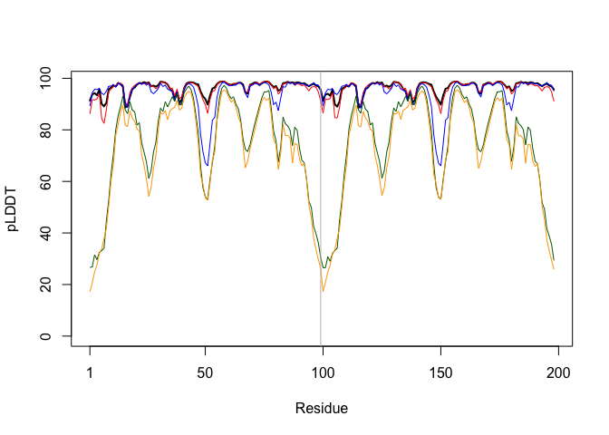

## 3. My. Find-A-Gene Sequence

### Read the AF model

``` r
list.files(path="GeneProject_PC_4d69b/",
           full.names = F,
           pattern = ".pdb")
```

    [1] "GeneProject_PC_4d69b_unrelaxed_rank_001_alphafold2_ptm_model_5_seed_000.pdb"
    [2] "GeneProject_PC_4d69b_unrelaxed_rank_002_alphafold2_ptm_model_4_seed_000.pdb"
    [3] "GeneProject_PC_4d69b_unrelaxed_rank_003_alphafold2_ptm_model_3_seed_000.pdb"
    [4] "GeneProject_PC_4d69b_unrelaxed_rank_004_alphafold2_ptm_model_1_seed_000.pdb"
    [5] "GeneProject_PC_4d69b_unrelaxed_rank_005_alphafold2_ptm_model_2_seed_000.pdb"

``` r
pdb_files3 <- list.files(path="GeneProject_PC_4d69b/",
           full.names = T,
           pattern = ".pdb")
```

``` r
library(bio3d)
pdbs3 <- pdbaln(pdb_files3, fit=TRUE, exefile = "msa")
```

    Reading PDB files:
    GeneProject_PC_4d69b//GeneProject_PC_4d69b_unrelaxed_rank_001_alphafold2_ptm_model_5_seed_000.pdb
    GeneProject_PC_4d69b//GeneProject_PC_4d69b_unrelaxed_rank_002_alphafold2_ptm_model_4_seed_000.pdb
    GeneProject_PC_4d69b//GeneProject_PC_4d69b_unrelaxed_rank_003_alphafold2_ptm_model_3_seed_000.pdb
    GeneProject_PC_4d69b//GeneProject_PC_4d69b_unrelaxed_rank_004_alphafold2_ptm_model_1_seed_000.pdb
    GeneProject_PC_4d69b//GeneProject_PC_4d69b_unrelaxed_rank_005_alphafold2_ptm_model_2_seed_000.pdb
    .....

    Extracting sequences

    pdb/seq: 1   name: GeneProject_PC_4d69b//GeneProject_PC_4d69b_unrelaxed_rank_001_alphafold2_ptm_model_5_seed_000.pdb 
    pdb/seq: 2   name: GeneProject_PC_4d69b//GeneProject_PC_4d69b_unrelaxed_rank_002_alphafold2_ptm_model_4_seed_000.pdb 
    pdb/seq: 3   name: GeneProject_PC_4d69b//GeneProject_PC_4d69b_unrelaxed_rank_003_alphafold2_ptm_model_3_seed_000.pdb 
    pdb/seq: 4   name: GeneProject_PC_4d69b//GeneProject_PC_4d69b_unrelaxed_rank_004_alphafold2_ptm_model_1_seed_000.pdb 
    pdb/seq: 5   name: GeneProject_PC_4d69b//GeneProject_PC_4d69b_unrelaxed_rank_005_alphafold2_ptm_model_2_seed_000.pdb 

``` r
pdbs3
```

                                   1        .         .         .         .         50 
    [Truncated_Name:1]GeneProjec   YYLELAHQLVKEDIHILCIKDMAGLLTPPAATMLVSALKKEFPTVPLHVH
    [Truncated_Name:2]GeneProjec   YYLELAHQLVKEDIHILCIKDMAGLLTPPAATMLVSALKKEFPTVPLHVH
    [Truncated_Name:3]GeneProjec   YYLELAHQLVKEDIHILCIKDMAGLLTPPAATMLVSALKKEFPTVPLHVH
    [Truncated_Name:4]GeneProjec   YYLELAHQLVKEDIHILCIKDMAGLLTPPAATMLVSALKKEFPTVPLHVH
    [Truncated_Name:5]GeneProjec   YYLELAHQLVKEDIHILCIKDMAGLLTPPAATMLVSALKKEFPTVPLHVH
                                   ************************************************** 
                                   1        .         .         .         .         50 

                                  51        .         .         .         .         100 
    [Truncated_Name:1]GeneProjec   THDTSGAGVAAMLACAHAGADVVDCAVDSMSGITSQPSMGAIVASLQNTP
    [Truncated_Name:2]GeneProjec   THDTSGAGVAAMLACAHAGADVVDCAVDSMSGITSQPSMGAIVASLQNTP
    [Truncated_Name:3]GeneProjec   THDTSGAGVAAMLACAHAGADVVDCAVDSMSGITSQPSMGAIVASLQNTP
    [Truncated_Name:4]GeneProjec   THDTSGAGVAAMLACAHAGADVVDCAVDSMSGITSQPSMGAIVASLQNTP
    [Truncated_Name:5]GeneProjec   THDTSGAGVAAMLACAHAGADVVDCAVDSMSGITSQPSMGAIVASLQNTP
                                   ************************************************** 
                                  51        .         .         .         .         100 

                                 101        .         .         .         .         150 
    [Truncated_Name:1]GeneProjec   LDTGIPLGSVSQLSDYWEQVRGFYAPFDCTATLKSGSSDVFNHEIPGGQY
    [Truncated_Name:2]GeneProjec   LDTGIPLGSVSQLSDYWEQVRGFYAPFDCTATLKSGSSDVFNHEIPGGQY
    [Truncated_Name:3]GeneProjec   LDTGIPLGSVSQLSDYWEQVRGFYAPFDCTATLKSGSSDVFNHEIPGGQY
    [Truncated_Name:4]GeneProjec   LDTGIPLGSVSQLSDYWEQVRGFYAPFDCTATLKSGSSDVFNHEIPGGQY
    [Truncated_Name:5]GeneProjec   LDTGIPLGSVSQLSDYWEQVRGFYAPFDCTATLKSGSSDVFNHEIPGGQY
                                   ************************************************** 
                                 101        .         .         .         .         150 

                                 151        .         .         .         .         200 
    [Truncated_Name:1]GeneProjec   TNLHMQAWALGMAAQWPEIKHSYAEANQLLGDIIKVTPSSKVVGDFAQFM
    [Truncated_Name:2]GeneProjec   TNLHMQAWALGMAAQWPEIKHSYAEANQLLGDIIKVTPSSKVVGDFAQFM
    [Truncated_Name:3]GeneProjec   TNLHMQAWALGMAAQWPEIKHSYAEANQLLGDIIKVTPSSKVVGDFAQFM
    [Truncated_Name:4]GeneProjec   TNLHMQAWALGMAAQWPEIKHSYAEANQLLGDIIKVTPSSKVVGDFAQFM
    [Truncated_Name:5]GeneProjec   TNLHMQAWALGMAAQWPEIKHSYAEANQLLGDIIKVTPSSKVVGDFAQFM
                                   ************************************************** 
                                 151        .         .         .         .         200 

                                 201     207 
    [Truncated_Name:1]GeneProjec   VQNGVNK
    [Truncated_Name:2]GeneProjec   VQNGVNK
    [Truncated_Name:3]GeneProjec   VQNGVNK
    [Truncated_Name:4]GeneProjec   VQNGVNK
    [Truncated_Name:5]GeneProjec   VQNGVNK
                                   ******* 
                                 201     207 

    Call:
      pdbaln(files = pdb_files3, fit = TRUE, exefile = "msa")

    Class:
      pdbs, fasta

    Alignment dimensions:
      5 sequence rows; 207 position columns (207 non-gap, 0 gap) 

    + attr: xyz, resno, b, chain, id, ali, resid, sse, call

### RMSD

``` r
rd3 <- rmsd(pdbs3, fit=T)
```

    Warning in rmsd(pdbs3, fit = T): No indices provided, using the 207 non NA positions

``` r
range(rd3)
```

    [1] 0.000 0.579

``` r
library(pheatmap)

colnames(rd3) <- paste0("m",1:5)
rownames(rd3) <- paste0("m",1:5)
pheatmap(rd3)
```

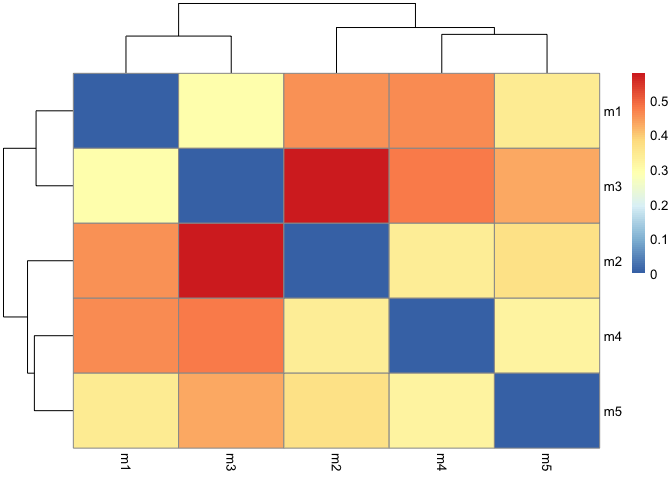

### RMSF

``` r
rf3 <- rmsf(pdbs3$xyz)
plot.bio3d(rf3)
```

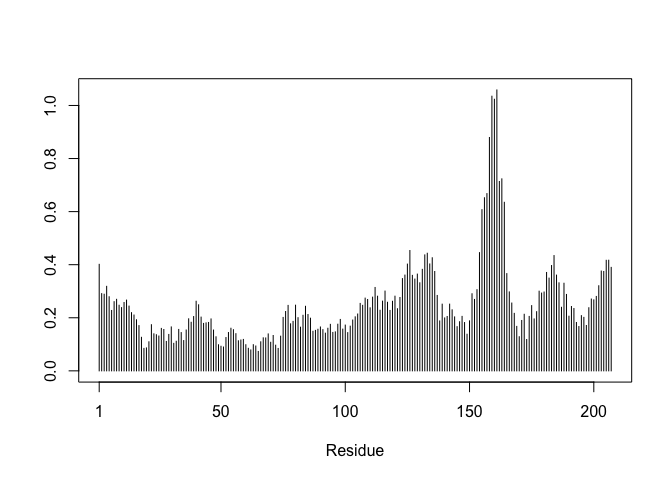

### Residue Conservation

``` r
aln_file3 <- list.files(path="GeneProject_PC_4d69b/",
                       pattern=".a3m$",
                        full.names = TRUE)
aln_file3
```

    [1] "GeneProject_PC_4d69b//GeneProject_PC_4d69b.a3m"

``` r
aln3 <- read.fasta(aln_file3[1], to.upper = TRUE)
```

    [1] " ** Duplicated sequence id's: 101 **"

``` r
sim3 <- conserv(aln3)
```

``` r
plot(sim3, typ = "h")
```

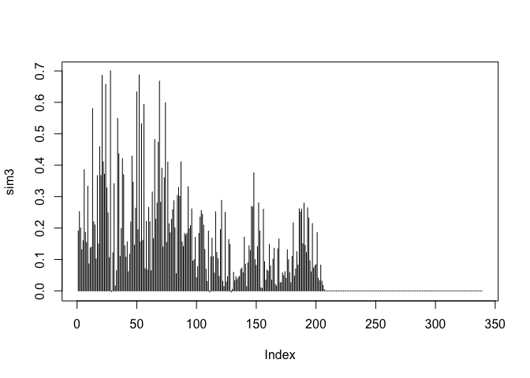

``` r
con3 <- consensus (aln3, cutoff = 0.90)
con3$seq
```

      [1] "-" "-" "-" "-" "-" "-" "-" "-" "-" "-" "-" "-" "-" "-" "-" "-" "-" "-"
     [19] "-" "-" "-" "-" "-" "-" "-" "-" "-" "-" "-" "-" "-" "-" "-" "-" "-" "-"
     [37] "-" "-" "-" "-" "-" "-" "-" "-" "-" "-" "-" "-" "-" "-" "-" "-" "-" "-"
     [55] "-" "-" "-" "-" "-" "-" "-" "-" "-" "-" "-" "-" "-" "-" "-" "-" "-" "-"
     [73] "-" "-" "-" "-" "-" "-" "-" "-" "-" "-" "-" "-" "-" "-" "-" "-" "-" "-"
     [91] "-" "-" "-" "-" "-" "-" "-" "-" "-" "-" "-" "-" "-" "-" "-" "-" "-" "-"
    [109] "-" "-" "-" "-" "-" "-" "-" "-" "-" "-" "-" "-" "-" "-" "-" "-" "-" "-"
    [127] "-" "-" "-" "-" "-" "-" "-" "-" "-" "-" "-" "-" "-" "-" "-" "-" "-" "-"
    [145] "-" "-" "-" "-" "-" "-" "-" "-" "-" "-" "-" "-" "-" "-" "-" "-" "-" "-"
    [163] "-" "-" "-" "-" "-" "-" "-" "-" "-" "-" "-" "-" "-" "-" "-" "-" "-" "-"
    [181] "-" "-" "-" "-" "-" "-" "-" "-" "-" "-" "-" "-" "-" "-" "-" "-" "-" "-"
    [199] "-" "-" "-" "-" "-" "-" "-" "-" "-" "-" "-" "-" "-" "-" "-" "-" "-" "-"
    [217] "-" "-" "-" "-" "-" "-" "-" "-" "-" "-" "-" "-" "-" "-" "-" "-" "-" "-"
    [235] "-" "-" "-" "-" "-" "-" "-" "-" "-" "-" "-" "-" "-" "-" "-" "-" "-" "-"
    [253] "-" "-" "-" "-" "-" "-" "-" "-" "-" "-" "-" "-" "-" "-" "-" "-" "-" "-"
    [271] "-" "-" "-" "-" "-" "-" "-" "-" "-" "-" "-" "-" "-" "-" "-" "-" "-" "-"
    [289] "-" "-" "-" "-" "-" "-" "-" "-" "-" "-" "-" "-" "-" "-" "-" "-" "-" "-"
    [307] "-" "-" "-" "-" "-" "-" "-" "-" "-" "-" "-" "-" "-" "-" "-" "-" "-" "-"
    [325] "-" "-" "-" "-" "-" "-" "-" "-" "-" "-" "-" "-" "-" "-" "-"

``` r
con3 <- consensus (aln3, cutoff = 0.75)
con3$seq
```

      [1] "-" "-" "-" "-" "-" "-" "-" "-" "-" "-" "-" "-" "G" "-" "-" "-" "-" "-"
     [19] "-" "-" "D" "-" "-" "G" "-" "-" "-" "P" "-" "-" "-" "-" "-" "-" "-" "-"
     [37] "-" "-" "-" "-" "-" "-" "-" "-" "-" "-" "-" "-" "-" "H" "-" "H" "-" "-"
     [55] "-" "G" "-" "-" "-" "-" "-" "-" "-" "-" "-" "-" "-" "-" "G" "-" "-" "-"
     [73] "-" "D" "-" "-" "-" "-" "-" "-" "-" "-" "-" "-" "-" "-" "-" "-" "-" "-"
     [91] "-" "-" "-" "-" "-" "-" "-" "-" "-" "-" "-" "-" "-" "-" "-" "-" "-" "-"
    [109] "-" "-" "-" "-" "-" "-" "-" "-" "-" "-" "-" "-" "-" "-" "-" "-" "-" "-"
    [127] "-" "-" "-" "-" "-" "-" "-" "-" "-" "-" "-" "-" "-" "-" "-" "-" "-" "-"
    [145] "-" "-" "-" "-" "-" "-" "-" "-" "-" "-" "-" "-" "-" "-" "-" "-" "-" "-"
    [163] "-" "-" "-" "-" "-" "-" "-" "-" "-" "-" "-" "-" "-" "-" "-" "-" "-" "-"
    [181] "-" "-" "-" "-" "-" "-" "-" "-" "-" "-" "-" "-" "-" "-" "-" "-" "-" "-"
    [199] "-" "-" "-" "-" "-" "-" "-" "-" "-" "-" "-" "-" "-" "-" "-" "-" "-" "-"
    [217] "-" "-" "-" "-" "-" "-" "-" "-" "-" "-" "-" "-" "-" "-" "-" "-" "-" "-"
    [235] "-" "-" "-" "-" "-" "-" "-" "-" "-" "-" "-" "-" "-" "-" "-" "-" "-" "-"
    [253] "-" "-" "-" "-" "-" "-" "-" "-" "-" "-" "-" "-" "-" "-" "-" "-" "-" "-"
    [271] "-" "-" "-" "-" "-" "-" "-" "-" "-" "-" "-" "-" "-" "-" "-" "-" "-" "-"
    [289] "-" "-" "-" "-" "-" "-" "-" "-" "-" "-" "-" "-" "-" "-" "-" "-" "-" "-"
    [307] "-" "-" "-" "-" "-" "-" "-" "-" "-" "-" "-" "-" "-" "-" "-" "-" "-" "-"
    [325] "-" "-" "-" "-" "-" "-" "-" "-" "-" "-" "-" "-" "-" "-" "-"

``` r
m3.pdb <- read.pdb(pdb_files3[1])
occ3 <- vec2resno(c(sim[1:207]), m3.pdb$atom$resno)
write.pdb(m3.pdb, o = occ3, file = "m3_conserv.pdb")
length(occ3)   # 1514, one value per atom
```

    [1] 1548

``` r
head(occ3)
```

    [1] 0.2612893 0.2612893 0.2612893 0.2612893 0.2612893 0.2612893

### AF scores (pLDDT & PAE score plots)

``` r
# Read and align the dimer models
pdbs3 <- pdbaln(pdb_files3, fit = TRUE, exefile = "msa")
```

    Reading PDB files:
    GeneProject_PC_4d69b//GeneProject_PC_4d69b_unrelaxed_rank_001_alphafold2_ptm_model_5_seed_000.pdb
    GeneProject_PC_4d69b//GeneProject_PC_4d69b_unrelaxed_rank_002_alphafold2_ptm_model_4_seed_000.pdb
    GeneProject_PC_4d69b//GeneProject_PC_4d69b_unrelaxed_rank_003_alphafold2_ptm_model_3_seed_000.pdb
    GeneProject_PC_4d69b//GeneProject_PC_4d69b_unrelaxed_rank_004_alphafold2_ptm_model_1_seed_000.pdb
    GeneProject_PC_4d69b//GeneProject_PC_4d69b_unrelaxed_rank_005_alphafold2_ptm_model_2_seed_000.pdb
    .....

    Extracting sequences

    pdb/seq: 1   name: GeneProject_PC_4d69b//GeneProject_PC_4d69b_unrelaxed_rank_001_alphafold2_ptm_model_5_seed_000.pdb 
    pdb/seq: 2   name: GeneProject_PC_4d69b//GeneProject_PC_4d69b_unrelaxed_rank_002_alphafold2_ptm_model_4_seed_000.pdb 
    pdb/seq: 3   name: GeneProject_PC_4d69b//GeneProject_PC_4d69b_unrelaxed_rank_003_alphafold2_ptm_model_3_seed_000.pdb 
    pdb/seq: 4   name: GeneProject_PC_4d69b//GeneProject_PC_4d69b_unrelaxed_rank_004_alphafold2_ptm_model_1_seed_000.pdb 
    pdb/seq: 5   name: GeneProject_PC_4d69b//GeneProject_PC_4d69b_unrelaxed_rank_005_alphafold2_ptm_model_2_seed_000.pdb 

``` r
# pLDDT (stored in the B-factor column) for each dimer model
plotb3(pdbs3$b[1, ], typ = "l", lwd = 2, ylab = "pLDDT")
points(pdbs3$b[2, ], typ = "l", col = "red")
points(pdbs3$b[3, ], typ = "l", col = "blue")
points(pdbs3$b[4, ], typ = "l", col = "darkgreen")
points(pdbs3$b[5, ], typ = "l", col = "orange")
```

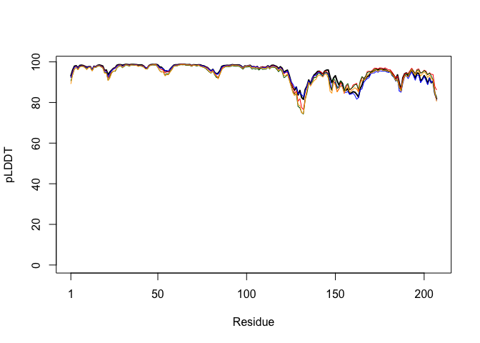
