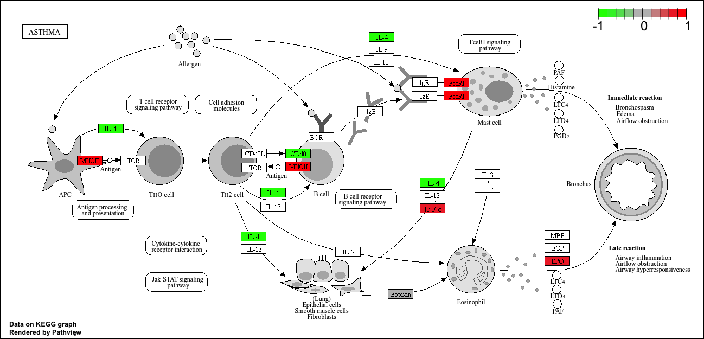
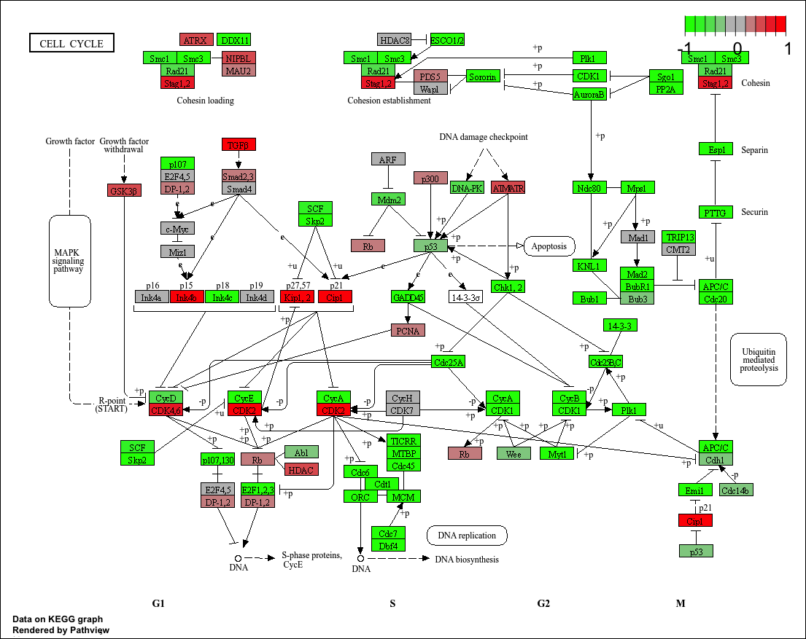
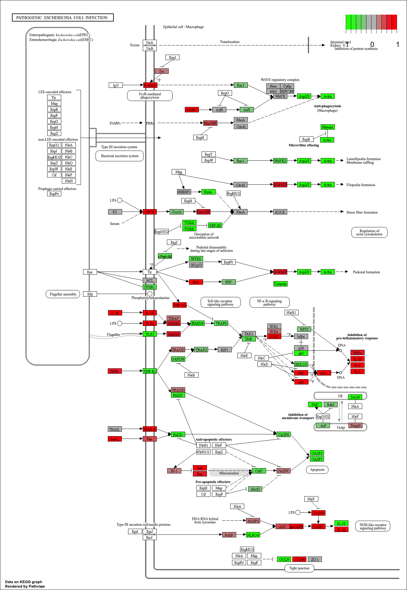
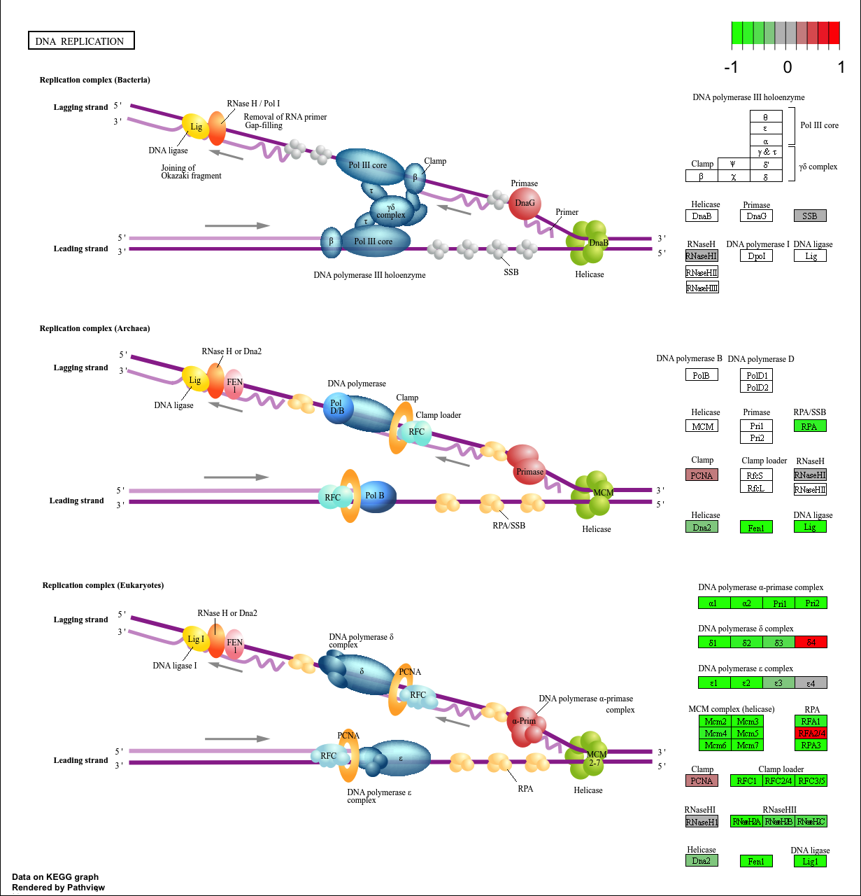
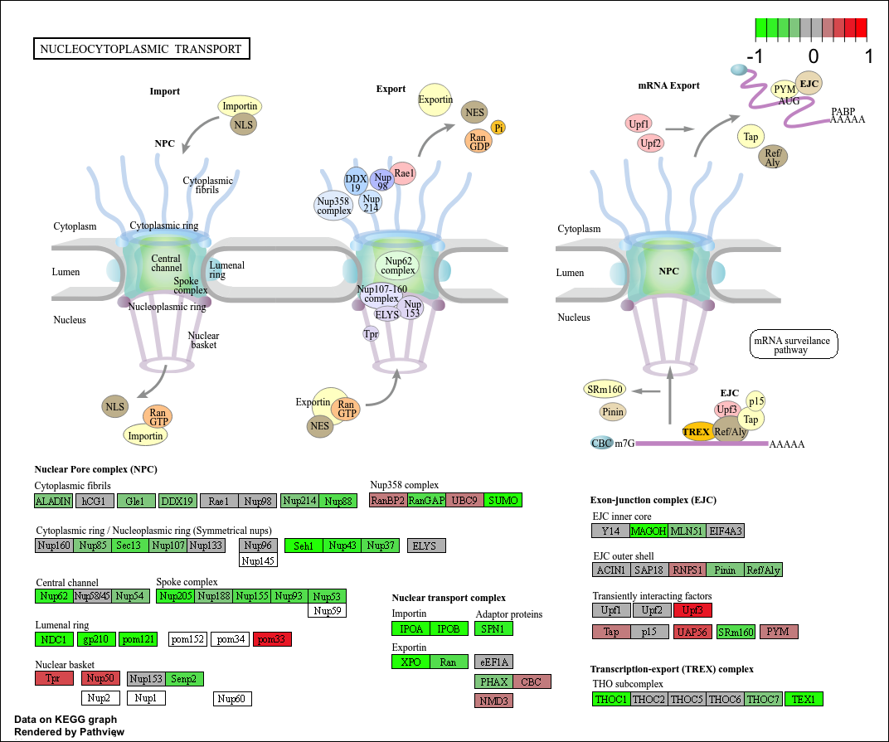
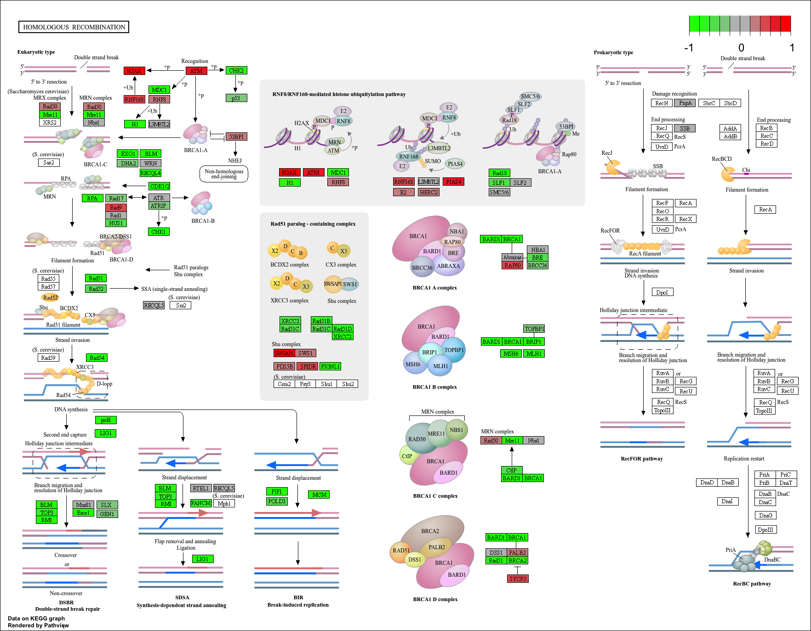

```{r}
library(DESeq2)
```

## 1. Differential Expression Analysis

```{r}
metaFile <- "GSE37704_metadata.csv"
countFile <- "GSE37704_featurecounts.csv"

# Import metadata and take a peek
colData = read.csv(metaFile, row.names=1)
head(colData)
```

```{r}
# Import countdata
countData = read.csv(countFile, row.names=1)
head(countData)
```

Remember that we need the countData and colData files to match up so we will need to remove that odd first column in countData namely countData\$length.

> > **Q1.** Complete the code below to remove the troublesome first column from countData

```{r}
# Note we need to remove the odd first $length col
countData <- as.matrix(countData[, -1])
head(countData)
```

> > **Q2.** Complete the code below to filter countData to exclude genes (i.e. rows) where we have 0 read count across all samples (i.e. columns).

Tip: What will rowSums() of countData return and how could you use it in this context?

```{r}
# Filter count data where you have 0 read count across all samples.
countData = countData[rowSums(countData) > 0, ]
head(countData)
```

### Running DESeq2

Nice now lets setup the DESeqDataSet object required for the `DESeq()` function and then run the DESeq pipeline. This is again similar to our last day's hands-on session.

```{r}
dds = DESeqDataSetFromMatrix(countData = countData,
                             colData = colData,
                             design = ~condition)
dds = DESeq(dds)
dds
```

Next, get results for the HoxA1 knockdown versus control siRNA (remember that these were labeled as "hoxa1_kd" and "control_sirna" in our original colData metaFile input to DESeq, you can check this above and by running resultsNames(dds) command).

```{r}
res = results(dds)
```

> > **Q3.** Call the summary() function on your results to get a sense of how many genes are up or down-regulated at the default 0.1 p-value cutoff.

```{r}
summary(res)
```

### Volcano Plot

Now we will make a volcano plot, a commonly produced visualization from this type of data that we introduced last day. Basically it's a plot of log2 fold change vs -log adjusted p-value.

```{r}
library(ggplot2)

ggplot(as.data.frame(res)) +
  aes(log2FoldChange,
      -log(padj)) +
  geom_point()
```

> > **Q4.** Improve this plot by completing the below code, which adds color, axis labels and cutoff lines:

```{r}
# Make a color vector for all genes
mycols <- rep("gray", nrow(res))

# Color blue the genes with fold change above 2
mycols[ abs(res$log2FoldChange) > 2 ] <- "blue"

# Color gray those with adjusted p-value more than 0.01
mycols[ res$padj > 0.01 ] <- "gray"

ggplot(as.data.frame(res)) +
  aes(log2FoldChange,
      -log(padj)) +
  geom_point(col = mycols) +
  xlab("Log2(FoldChange)") +
  ylab("-Log(P-value)") +
  geom_vline(xintercept = c(-2, 2)) +
  geom_hline(yintercept = -log(0.01))
```

### Adding Annotation

Our many results to date are in the object called `res`. It has only ENSEMBLE IDs at the moment `rownames(res)`

```{r}
head(res)
```

We will use two bioconductor packages to add gene symbols and entrez IDs to our results. These are **AnnotationDbi** and **org.Hs.eg.db**

To install these we need to use BiocManager `BiocManager::install()`

```{r}
library(AnnotationDbi)
library(org.Hs.eg.db)
```

Let's first have a peek at our database ..

```{r}
columns(org.Hs.eg.db)
```

> > **Q5.** Use the mapIDs() function multiple times to add SYMBOL, ENTREZID and GENENAME annotation to our results by completing the code below.

We can use the `mapIds()` function to translate or map our "ENSEMBL" format rownames to gene "SYMBOL" etc.

```{r}
res$symbol <- mapIds(org.Hs.eg.db,
       keys=rownames(res), # Our current IDs
       keytype = "ENSEMBL", # Their current format
       column = "SYMBOL") # The format we want!

res$entrez <- mapIds(org.Hs.eg.db,
                    keys=rownames(res),
                    keytype="ENSEMBL",
                    column="ENTREZID",
                    multiVals="first")

res$name <-  mapIds(org.Hs.eg.db,
                    keys=row.names(res),
                    keytype="ENSEMBL",
                    column="GENENAME",
                    multiVals="first")

head(res, 10)
```

> > **Q6.** Finally for this section let's reorder these results by adjusted p-value and save them to a CSV file in your current project directory.

```{r}
res = res[order(res$pvalue),]
write.csv(res, file = "deseq_results.csv")
```

## 2. Pathway Analysis

For this analysis, we need 3 more packages that we can install with `BiocManager::install( c("pathview", "gage", "gageData") )`

```{r}
library(gage)
library(gageData)
library(pathview)
```

As input gage wants a simple vector of importance (e.g., our log2 fold-change values) that has the correct gene IDs set as the `names()`

```{r}
foldchanges <- res$log2FoldChange
names(foldchanges) <- res$entrez
head(foldchanges)
```

```{r}
# Load my gene-sets/pathways

data(kegg.sets.hs)

# Get the results

keggres = gage(foldchanges, gsets=kegg.sets.hs)
```

What is in our gage results?

```{r}
attributes(keggres)
```

Look at the top 3 "down regulated" KEGG pathways

```{r}
# Look at the first few down (less) pathways
head(keggres$less, 3)
```

We can take any of these "pathways" via their KEGG hsa ID and our `foldchanges` vector and see how our genes map to the pathway.

```{r}
pathview(gene.data=foldchanges, pathway.id="hsa05310")
pathview(gene.data=foldchanges, pathway.id="hsa04110")
pathview(gene.data=foldchanges, pathway.id="hsa05130")
```





 \>\>**Q7.** Can you do the same procedure as above to plot the pathview figures for the top 5 down-regulated pathways?

```{r}
# Look at the first few up (more) pathways
head(keggres$less, 5)
```

```{r}
pathview(gene.data=foldchanges, pathway.id="hsa04110")
pathview(gene.data=foldchanges, pathway.id="hsa03030")
pathview(gene.data=foldchanges, pathway.id="hsa05130")
pathview(gene.data=foldchanges, pathway.id="hsa03013")
pathview(gene.data=foldchanges, pathway.id="hsa03440")
```

    

## 3. Gene Ontology

```{r}
data(go.sets.hs)
data(go.subs.hs)

# Focus on Biological Process subset of GO
gobpsets = go.sets.hs[go.subs.hs$BP]

gobpres = gage(foldchanges, gsets=gobpsets)

lapply(gobpres, head)
```

## 4. Reactome Analysis

```{r}
sig_genes <- res[res$padj <= 0.05 & !is.na(res$padj), "symbol"]
print(paste("Total number of significant genes:", length(sig_genes)))
```

```{r}
write.table(sig_genes, file="significant_genes.txt", row.names=FALSE, col.names=FALSE, quote=FALSE)
```

> > **Q8.** What pathway has the most significant “Entities p-value”? Do the most significant pathways listed match your previous KEGG results? What factors could cause differences between the two methods?

**Cell cycle, mitotic** has the most significant entities p-value (p=1.48E-5) in Reactome. This is the most significant pathway in both Reactome and KEGG, with reactome analysis showing more specific hits. The other pathways specified in Reactome do not match exactly what's on KEGG. This is because Reactome draws from numerous databases which allows hits that are both general and much more granular, while KEGG only draws from its own database. For example, in the KEGG results, DNA replication immediately follows the cell cycle, while the Reactome show more pathways that are involved in the cell cycle, and more non-cell cycle hits that are involved in mainstream metabolism and RNA metabolism.

## Save our results to CSV

Finally for this section let's reorder these results by adjusted p-value and save them to a CSV in your current project directory.

```{r}
res = res[order(res$pvalue),]
write.csv(res, file="deseq_results.csv")
```

